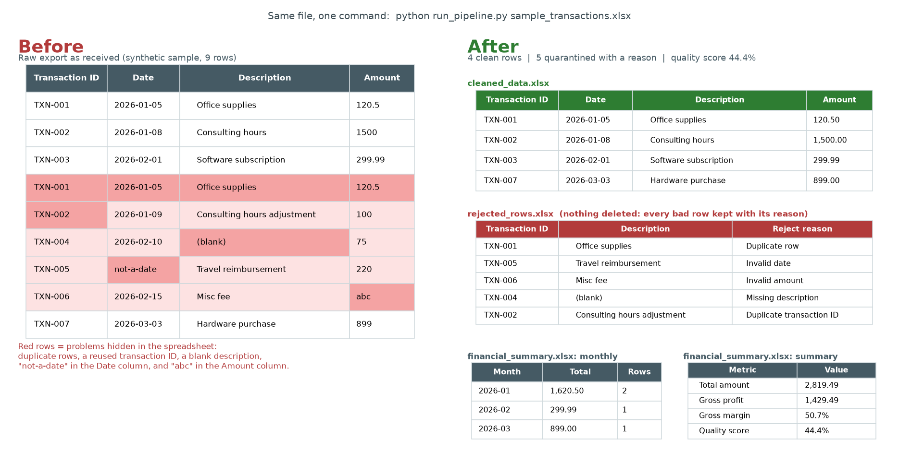

# Turn messy finance spreadsheets into clean, audit-ready reports, automatically

**Stop fixing the same Excel errors every month.** This Python pipeline takes raw transaction files (Excel or CSV), finds and quarantines bad data, and produces clean data, a financial summary, and a data-quality report with one command.



## What it does for your business

- **Catches errors before they reach your reports.** Missing required values, duplicate transactions, invalid dates, and bad amounts are flagged automatically.
- **Never silently deletes data.** Every rejected row is kept in a separate file with the reason it was rejected, so nothing gets lost.
- **Produces ready-to-use reports.** Cleaned data, a financial summary with monthly totals, and a quality score, all exported to Excel.
- **Keeps an audit trail.** Every run is logged with its row counts, rejects, and quality score, and every rejected row carries its reason, so you can show exactly what changed and why.
- **Accepts the export you already have.** Bank statements, QuickBooks, and shop backends such as Shopee can use different column names, including Traditional Chinese headers. The pipeline maps them to one schema.
- **Understands Taiwan formats.** Republic of China (民國) dates, `NT$` amounts, full-width digits, and accounting parentheses are parsed. Reports can be labeled in 繁體中文.

## Typical use cases

- Cleaning bank, QuickBooks, or accounting exports before month-end close
- Replacing a manual, copy-paste Excel reporting routine
- Checking data quality before importing into another system
- Producing consistent monthly summaries that anyone can rerun

> Need this set up for your own data? See **Work with me** at the bottom.

---

## Technical overview: Financial Data Automation & Data Quality Pipeline

A reproducible Python pipeline for validating, cleaning, analyzing, and reporting financial datasets with deterministic data-quality controls and append-only audit evidence.

## Problem

Manual Excel/CSV finance workflows often accumulate:

- missing values
- inconsistent column names and schemas
- duplicate records
- invalid dates or amounts
- repetitive, hard-to-audit reporting

This repository automates a small, transparent path from raw files to cleaned outputs, metrics, and evidence.

## Architecture

```text
Raw Data
   ↓
Ingestion
   ↓
Column mapping
   ↓
Validation
   ↓
Data Quality
   ↓
Cleaning
   ↓
Financial Analytics
   ↓
Reporting
   ↓
Verification
   ↓
Audit Evidence
```

## Features

- CSV and XLSX ingestion with column-name normalization (UTF-8, UTF-16, and Big5/cp950)
- Automatic column mapping: built-in synonyms, fuzzy matching for English typos, and an optional mapping file
- Required-schema validation (`transaction_id`, `date`, `description`, `amount`)
- ROC (民國) dates and TWD amount formats
- Report labels in English or Traditional Chinese (`zh-TW`)
- A local web page for non-technical users (`streamlit run streamlit_app.py`)
- Deterministic data-quality checks
- Cleaning that quarantines bad rows instead of silently dropping them
- Financial summary metrics and optional monthly totals
- Excel/CSV reporting under `data/processed/`
- Simple quality score: `clean_rows / input_rows` (documented formula; not a weighted model score)
- Append-only JSONL audit evidence in `evidence/audit.jsonl` (`duplicates_removed` counts exact-row and duplicate-id rejects)
- pytest coverage for core behaviors

## Quick start (Windows PowerShell)

```powershell
cd financial-data-automation
py -3.12 -m venv .venv
.\.venv\Scripts\Activate.ps1
python -m pip install -r requirements.txt
python scripts\generate_sample_data.py
python -m pytest
python run_pipeline.py --help
python run_pipeline.py data/sample/sample_transactions.xlsx
```

### Traditional Chinese sample

```powershell
python run_pipeline.py data/sample/sample_transactions_zh_tw.csv --language zh-TW
python run_pipeline.py data/sample/sample_bank_statement_zh_tw.csv
```

Bank exports that split money into 支出 and 存入 are combined into `amount` (deposits positive, withdrawals negative). The original columns are kept.

### Column mapping file

When a header is not recognized, pass a CSV, JSON, or Excel file with two columns, `source` and `target` (來源 / 目標 also work):

```powershell
python run_pipeline.py export.csv --mapping data/sample/column_mapping.example.csv
```

```csv
source,target
訂單編號,transaction_id
交易日期,date
摘要,description
金額,amount
支出,debit
存入,credit
```

JSON works too: `{"訂單編號": "transaction_id"}`. If a required field still cannot be mapped, the run stops and names the columns it saw. Nothing is deleted.

### Web UI

```powershell
python -m pip install -r requirements-ui.txt
streamlit run streamlit_app.py
```

Open the URL Streamlit prints (http://localhost:8501). Choose English or 繁體中文, upload a CSV or Excel file, optionally upload a mapping file, then download the cleaned data, rejected rows, financial summary, and quality report.

### CLI

`python run_pipeline.py --help` prints usage and exits 0. `-h` does the same. A missing file name or an unknown flag exits with code 2.

```text
python run_pipeline.py INPUT [--mapping FILE] [--language {en,zh-TW}] [--output-dir DIR] [--evidence FILE]
```

### Expected outputs

After a successful demo run:

```text
data/processed/cleaned_data.xlsx
data/processed/rejected_rows.xlsx
data/processed/financial_summary.xlsx
data/processed/quality_report.csv
evidence/audit.jsonl
```

## Design principles

```text
Deterministic
Auditable
Reproducible
Minimal dependencies
Separation of validation and cleaning
No silent data loss
```

Validation reports problems. Cleaning decides what to quarantine and records a `reject_reason` for every rejected row.

## Quality score

```text
quality_score = clean_rows / input_rows
```

If `input_rows` is 0, the score is `0.0`.

## Portfolio relevance

This project demonstrates practical skills for:

- financial data automation
- data quality and validation
- analytics and reporting
- lightweight data governance / audit evidence
- technology risk-friendly reproducibility

It is intentionally small. It is not a claim of enterprise production certification.

## Project layout

```text
src/financial_data_automation/   package code
streamlit_app.py                 local web UI
requirements-ui.txt              Streamlit dependency
tests/                           pytest suite
data/sample/                     synthetic demo inputs
data/processed/                  generated reports
evidence/                        append-only audit JSONL
docs/architecture.md             design boundaries
```

## README image (dev only)

`docs/before-after.png` is generated from a real pipeline run on the synthetic sample data. To regenerate it (matplotlib is a dev-only dependency, not needed to run the pipeline):

```powershell
python -m pip install matplotlib
python scripts\generate_sample_data.py
python scripts\make_readme_image.py
```

The script runs the pipeline into a temporary folder, so it does not touch `data/processed/` or `evidence/audit.jsonl`.

## 給台灣的會計與小商店

這個工具把銀行對帳單、QuickBooks、蝦皮後台匯出的 Excel 或 CSV，整理成可稽核的報表。

- 欄位名稱可以是繁體中文。常見的銀行、QuickBooks、蝦皮欄位會自動對應；對不到時可用對應檔，不會把資料偷偷刪掉。
- 日期接受民國格式，例如 `113/05/01`、`113年5月1日`。金額接受 `NT$1,234`、全形數字，以及括號負數 `(1,234)`。
- 支出與存入會合成金額欄：存入是正數，支出是負數，原始欄位仍保留。
- 報表可以輸出繁體中文：`python run_pipeline.py 檔案.csv --language zh-TW`
- 不想用指令的話，安裝介面後執行 `streamlit run streamlit_app.py`，用瀏覽器上傳檔案並下載結果。

有問題的列會另外存成檔案，並寫明剔除原因。每一輪執行都會附加到 `evidence/audit.jsonl`，不會覆寫舊紀錄。

## License / data note

Sample data is synthetic. Do not place real customer or account data in this repository.

## Work with me

I build custom versions of this pipeline for small businesses and finance teams: cleaning your exports, automating your monthly reports, and adding reconciliation checks and dashboards.

- Portfolio: https://kozphy.github.io
- Upwork: [add your Upwork profile link here]
